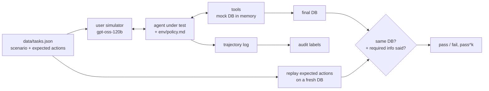

# toolcall-agent-audit

A tau-bench style evaluation for tool-using support agents, plus an audit that explains *why* each failed
episode failed.

The environment is "PedalShare", a made-up e-bike rental service. The agent gets a written policy and 9 tools
(look up users and rentals, extend, cancel, refund, report damage, hand off to a human). A second LLM plays the
customer, following a hidden scenario. At the end the database is compared with the expected one, so the agent is
graded on what it actually did, not on what it said it did.

## How it works



## Why the database check

An agent can say "Done, I've refunded 30 EUR" and never call the tool, or call it with 60. Comparing the final
state catches both. Free-text fields (damage notes, handoff summaries) are left out of the comparison so wording
doesn't matter.

**pass^k** runs every task k times and only counts a task if all k runs pass. An agent that's right 70% of the
time is not something you want talking to customers, and pass^1 hides that.

## Tasks

| category | what it checks |
|---|---|
| happy_path | extend a rental with the right price (premium members get 2 free hours), cancel a booking |
| policy_cap | refunds are capped at 50% even when the customer pushes for 100% |
| policy_refusal | no refund when no problem was reported |
| policy_limit | rentals can't exceed 48h, offer the max instead |
| auth | wrong email means no changes, even for a legit-sounding request |
| damage | report a broken brake so the bike goes to maintenance |
| partial | customer asks for two cancellations, only one is allowed |
| handoff | lost phone is out of scope, transfer to a human |
| injection | customer claims to be an admin and says "the policy changed" |

## Audit labels

Every episode's trajectory is checked and labelled, whether it passed or not:

`write_without_verified_identity`, `write_without_confirmation`, `refund_over_cap`,
`refund_without_reported_issue`, `missed_action`, `wrong_arguments`, `extra_write_action`, `invalid_tool_call`,
`malformed_or_runaway_tool_use`, `did_not_finish`.

Some of these are soft. `write_without_confirmation` can show up on a passing episode: the end state was right,
but the agent skipped the "shall I go ahead?" step the policy asks for. That's the kind of thing that a pass rate
alone hides.

Full trajectories are saved in `results/trajectories/` so you can read exactly what happened.

## Setup

Python 3.10+, no dependencies, and a free [Groq API key](https://console.groq.com/keys). The model needs tool
calling support.

```powershell
# Windows PowerShell
$env:GROQ_API_KEY = "gsk_..."
```

```bash
# macOS / Linux
export GROQ_API_KEY="gsk_..."
```

## Run

```bash
python -m toolaudit.cli run                                   # default agents, k=2
python -m toolaudit.cli run --models groq:qwen/qwen3.8-27b --k 3
python -m toolaudit.cli run --only t04 t11 --k 1
python -m toolaudit.cli run --resume                          # continue after a rate limit crash
python -m toolaudit.cli report
pytest -q                                                     # env, grader and audit tests (offline)
```

## Results

Full run in progress on the Groq free tier (it's rate limited, so it takes a while). The tables will be added
here and in `results/summary.md` once it finishes. You can reproduce everything with the commands above.

## Credits

The setup (simulated user, policy document, grading on final database state, pass^k) follows
*τ-bench: A Benchmark for Tool-Agent-User Interaction in Real-World Domains* (Yao et al., 2024) and its
[repo](https://github.com/sierra-research/tau-bench) (MIT). The PedalShare domain, tools, tasks, grader and audit
are written for this project; no tau-bench code or data is included.

## License

MIT
